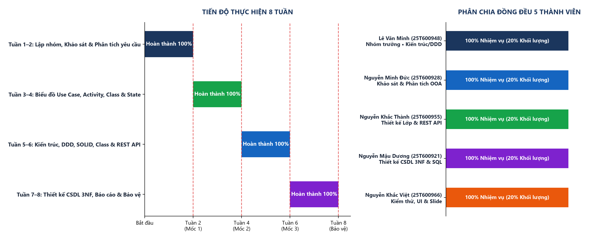
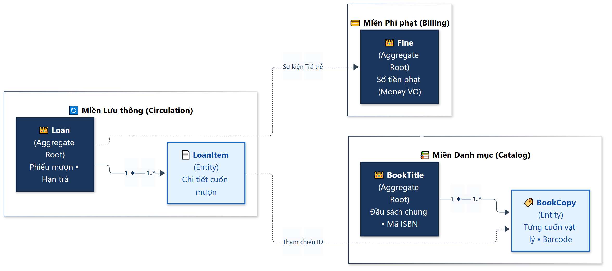
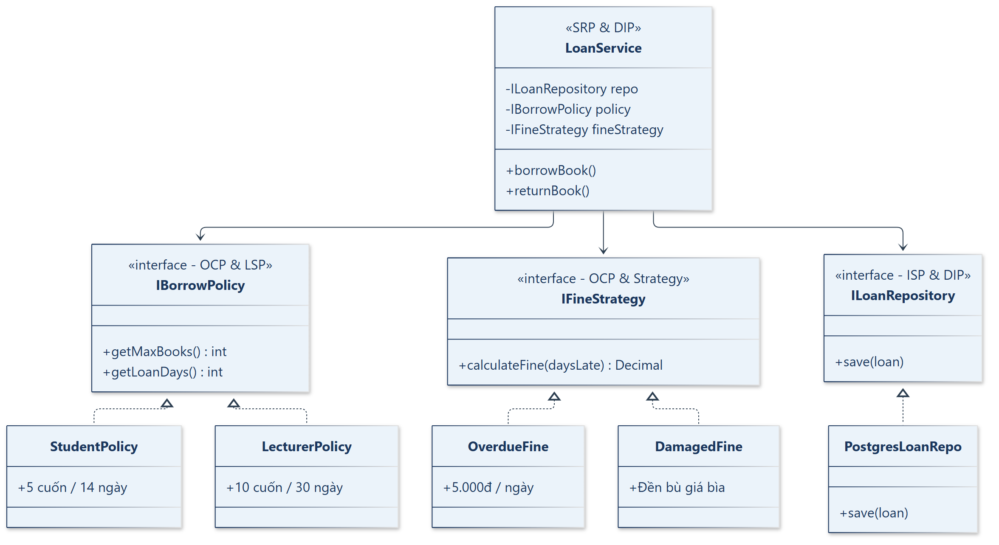
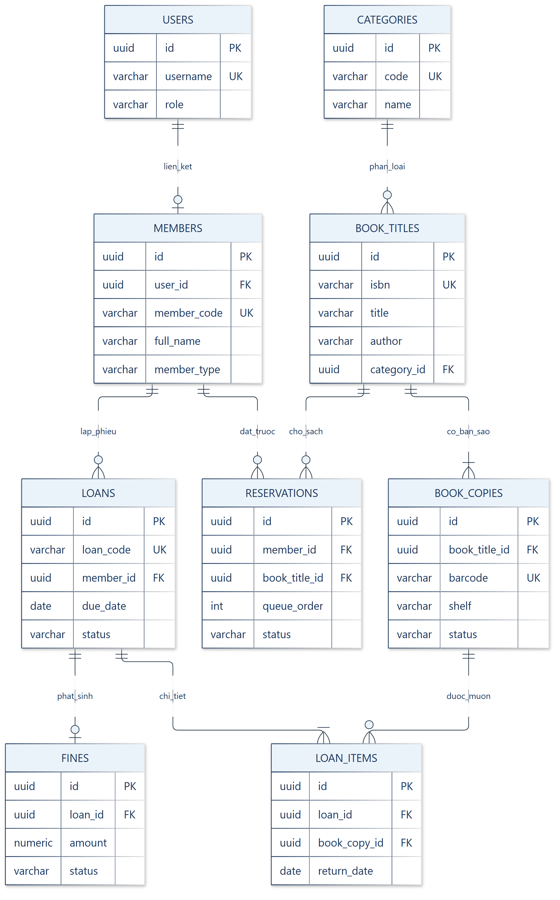
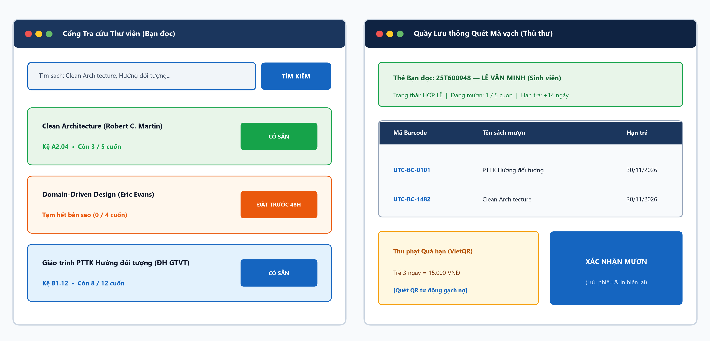

# 🏛️ Hệ Thống Quản Lý Thư Viện (UTC Smart Library)

> **Bài Tập Lớn Học Phần: Phân Tích Thiết Kế Hướng Đối Tượng (OOAD)**  
> **Trường Đại học Giao thông Vận tải (UTC) — Khoa Công nghệ Thông tin (2026)**  
> **Giảng viên hướng dẫn: TS. Đào Thị Lệ Thủy**

-7E22CE?style=flat-square)

---

## 👥 1. Thành Viên Nhóm & Phân Công

| STT | Họ và tên | Mã số SV | Nhiệm vụ chính |
|:---:|-----------|:--------:|----------------|
| 1 | **Lê Văn Minh** | `25T600948` | **Nhóm trưởng** • Kiến trúc Clean Architecture, DDD, SOLID & Tổng hợp Báo cáo |
| 2 | **Nguyễn Minh Đức** | `25T600928` | Khảo sát bài toán, Yêu cầu FR/NFR & Biểu đồ Use Case |
| 3 | **Nguyễn Khắc Thành** | `25T600955` | Activity Diagram, Design Class, Sequence Diagram & RESTful API |
| 4 | **Nguyễn Mậu Dương** | `25T600921` | State Machine Diagram, Thiết kế CSDL 9 bảng chuẩn 3NF & SQL |
| 5 | **Nguyễn Khắc Việt** | `25T600966` | Lập kế hoạch Excel, Giao diện UI Mockup, Kiểm thử nhất quán & Slide |

---

## 📦 2. Bộ Sản Phẩm Bàn Giao

1. 📄 **[BaoCao_BTL_PTTKHDT_QuanLyThuVien_Nhom.docx](./BaoCao_BTL_PTTKHDT_QuanLyThuVien_Nhom.docx)** — Báo cáo Word trình bày ngắn gọn, dễ hiểu, đầy đủ 5 chương + bìa + mục lục + phụ lục, nhúng **21 hình biểu đồ sắc nét** (không hiển thị code Mermaid).
2. 🖥️ **[Slide_ThuyetTrinh_QuanLyThuVien_Nhom.pptx](./Slide_ThuyetTrinh_QuanLyThuVien_Nhom.pptx)** — Slide thuyết trình **20 trang** ưu tiên hình ảnh và sơ đồ lớn, cực ít chữ.
3. 📊 **[KeHoach_PhanChiaCongViec_TienDo_Nhom.xlsx](./KeHoach_PhanChiaCongViec_TienDo_Nhom.xlsx)** — File Excel kế hoạch 8 tuần, sơ đồ Gantt trực quan, phân chia task tự động tính công thức.
4. 🗂️ **Thư mục [`resource/`](./resource/)**:
   - [`resource/image/`](./resource/image/): 22 ảnh biểu đồ `.png` rõ nét, chữ to dễ nhìn.
   - [`resource/mermaid-code/`](./resource/mermaid-code/): 19 file mã nguồn Mermaid `.mmd`.
   - [`resource/star-uml-file/UTC_Library_Management_System.mdj`](./resource/star-uml-file/UTC_Library_Management_System.mdj): Mô hình mở trực tiếp trên **StarUML**.
   - [`resource/database/utc_library_schema_seed.sql`](./resource/database/utc_library_schema_seed.sql): Kịch bản tạo 9 bảng PostgreSQL chuẩn 3NF.
   - [`resource/api/utc_library_openapi_v1.yaml`](./resource/api/utc_library_openapi_v1.yaml): Đặc tả RESTful API chuẩn OpenAPI 3.0.

---

## 🌟 3. Điểm Nhấn Thiết Kế (Đơn Giản – Dễ Hiểu – Xuất Sắc)

### Kiến trúc Clean Architecture & Domain-Driven Design (DDD)
Tách biệt rõ **Đầu sách (`BookTitle` – ISBN)** và **Cuốn sách vật lý (`BookCopy` – Barcode)** để quản lý chính xác từng cuốn trên kệ đồng thời hỗ trợ đặt trước tự động giữ chỗ 48 giờ.

### Áp dụng 5 nguyên lý SOLID & Strategy Pattern
Dễ dàng mở rộng thêm chính sách hạn mức mượn (`IBorrowPolicy`) hoặc công thức tính phạt mới (`IFineStrategy`) mà không cần sửa đổi mã nguồn cũ.

### Cơ sở dữ liệu 9 Bảng Chuẩn 3NF & Giao diện Minh họa

