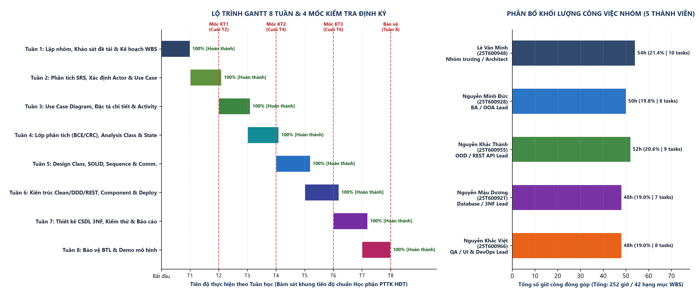
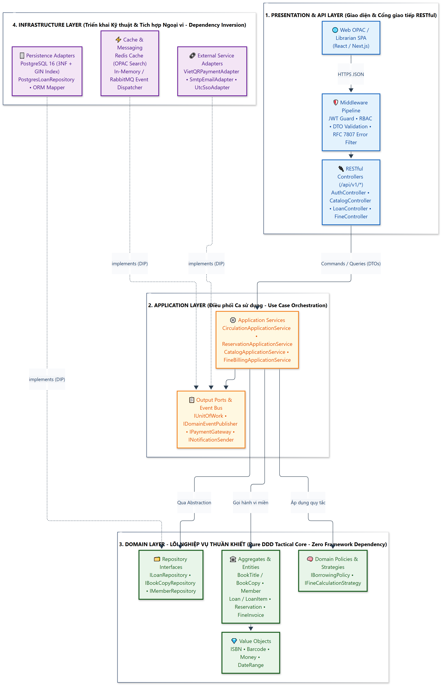
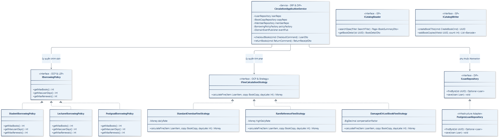
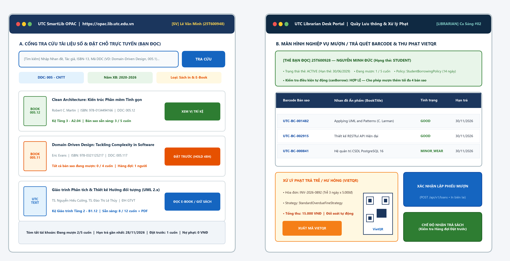
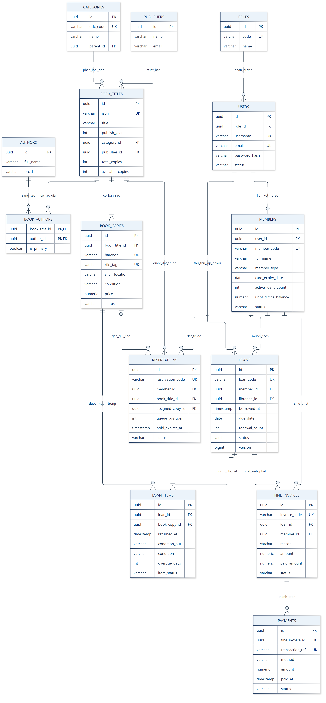

# 🏛️ Hệ Thống Quản Lý Thư Viện Số Thông Minh (UTC Smart Digital Library System)

> **Bài Tập Lớn Học Phần: Phân Tích Thiết Kế Hướng Đối Tượng (OOAD)**  
> **Trường Đại học Giao thông Vận tải (UTC) — Khoa Công nghệ Thông tin**  
> **Bộ môn Kỹ thuật Phần mềm và Hệ thống số • Năm học 2026**


-6A1B9A?style=flat-square)

---

## 📋 1. Thông Tin Chung & Nhóm Thực Hiện

- **Tên đề tài:** Phân tích và Thiết kế Hệ thống Quản lý Thư viện Số Thông minh (*UTC Smart Digital Library Management System – UTC LibMS*)
- **Học phần:** Phân tích Thiết kế Hướng đối tượng *(Hệ đào tạo từ xa – 3 tín chỉ)*
- **Giảng viên hướng dẫn:** **TS. Đào Thị Lệ Thủy**

### 👥 Danh sách thành viên & Phân công vai trò

| STT | Họ và tên | Mã số SV | Vai trò chuyên môn | Hạng mục phụ trách chính | Tỷ trọng |
|:---:|-----------|:--------:|--------------------|--------------------------|:--------:|
| 1 | **Lê Văn Minh** | `25T600948` | **Nhóm trưởng** • System Architect | Điều phối chung; NFR; Mô hình BCE & Analysis Class; Kiến trúc Clean Architecture, DDD (Strategic & Tactical), SOLID; Package, Component & Deployment Diagram; Biên tập Báo cáo | 21.4% (54h) |
| 2 | **Nguyễn Minh Đức** | `25T600928` | Business Analyst & OOA Lead | Khảo sát hiện trạng thư viện; Biểu đồ Context & Vấn đề–Giải pháp; Đặc tả 18 FR; Xác định Actor & 3 Biểu đồ Use Case; Đặc tả chi tiết UC lưu thông; State Machine `Loan` | 19.8% (50h) |
| 3 | **Nguyễn Khắc Thành** | `25T600955` | Backend OOD & RESTful API Lead | Quy ước UML; Activity Mượn/Trả; State Machine `BookCopy`; Design Class Diagram chi tiết & StarUML; 4 Sequence Diagrams; Kiến trúc RESTful API (24 endpoints) & OpenAPI 3.0 | 20.6% (52h) |
| 4 | **Nguyễn Mậu Dương** | `25T600921` | Database Architect & SQL Lead | Quy tắc nghiệp vụ `BR01–BR12`; Activity Đặt trước; Ánh xạ O–R; Lược đồ ERD 14 bảng; Từ điển dữ liệu; Chứng minh chuẩn hóa `1NF–3NF` & GIN Index; Kịch bản SQL PostgreSQL | 19.0% (48h) |
| 5 | **Nguyễn Khắc Việt** | `25T600966` | QA Verification, UI/UX & DevOps Lead | Lập kế hoạch WBS/Excel; Đặc tả UC Đặt chỗ/Biên mục/Phạt; Communication Diagram; Giao diện UI/UX Mockup & CI/CD Pipeline; Ma trận truy vết RTM & Test Cases; Slide thuyết trình | 19.0% (48h) |



---

## 📦 2. Danh Mục Sản Phẩm Bàn Giao Chính

| STT | Tệp sản phẩm | Định dạng | Mô tả nội dung chính |
|:---:|--------------|:---------:|----------------------|
| 1 | [**BaoCao_BTL_PTTKHDT_QuanLyThuVien_Nhom.docx**](./BaoCao_BTL_PTTKHDT_QuanLyThuVien_Nhom.docx) | `.docx` | **Báo cáo kỹ thuật hoàn chỉnh**: Đầy đủ Trang bìa khung viền đôi + Logo ĐH GTVT, Lời cảm ơn, Phiếu đánh giá GVHD, Phân công nhóm, Mục lục tự động, Danh mục Hình/Bảng/Từ viết tắt, Chương 1 → Chương 5, Kết luận, Tài liệu tham khảo IEEE, Phụ lục A–C. Nhúng **31 hình biểu đồ sắc nét** (không hiển thị code Mermaid thô). |
| 2 | [**Slide_ThuyetTrinh_QuanLyThuVien_Nhom.pptx**](./Slide_ThuyetTrinh_QuanLyThuVien_Nhom.pptx) | `.pptx` | **Slide thuyết trình bảo vệ (26 slides, 16:9)**: Thiết kế trực quan giàu hình ảnh và biểu đồ, cô đọng chữ trên slide, tích hợp đầy đủ kịch bản thuyết trình trong *Speaker Notes*. |
| 3 | [**KeHoach_PhanChiaCongViec_TienDo_Nhom.xlsx**](./KeHoach_PhanChiaCongViec_TienDo_Nhom.xlsx) | `.xlsx` | **Kế hoạch & Quản trị tiến độ dự án (6 Sheets)**: Dashboard KPI & biểu đồ tự động, WBS 42 đầu việc trong 8 tuần, sơ đồ Gantt 16 nửa tuần (4 mốc kiểm tra), ma trận trách nhiệm RACI, tự đánh giá Rubric 100 điểm và sổ quản lý rủi ro. |
| 4 | [**UTC_Library_Management_System.mdj**](./resource/star-uml-file/UTC_Library_Management_System.mdj) | `.mdj` | Mô hình dự án UML gốc mở trực tiếp trên phần mềm **StarUML** (Use Case Model & DDD/SOLID Design Class Model). |
| 5 | [**utc_library_schema_seed.sql**](./resource/database/utc_library_schema_seed.sql) | `.sql` | Kịch bản khởi tạo **14 bảng PostgreSQL 16 chuẩn 3NF**, ràng buộc toàn vẹn `PK/FK/UK/CHECK` và chỉ mục tối ưu `GIN Trigram` / `Partial B-Tree`. |
| 6 | [**utc_library_openapi_v1.yaml**](./resource/api/utc_library_openapi_v1.yaml) | `.yaml` | Đặc tả giao diện **RESTful API chuẩn OpenAPI 3.0.3** (nhập trực tiếp vào Swagger UI hoặc Postman). |

---

## 🗂️ 3. Cấu Trúc Thư Mục Dự Án

```text
oop/
├── README.md                                        # Tài liệu tổng quan & hướng dẫn sử dụng repository
├── guide.pdf                                        # Tài liệu hướng dẫn Bài tập lớn của Bộ môn
├── BaoCao_BTL_PTTKHDT_QuanLyThuVien_Nhom.docx       # [SẢN PHẨM 1] Báo cáo kỹ thuật hoàn chỉnh (Word)
├── Slide_ThuyetTrinh_QuanLyThuVien_Nhom.pptx        # [SẢN PHẨM 2] Slide thuyết trình bảo vệ (PowerPoint)
├── KeHoach_PhanChiaCongViec_TienDo_Nhom.xlsx        # [SẢN PHẨM 3] Kế hoạch WBS, Gantt, RACI & Tiến độ (Excel)
└── resource/                                        # Bộ tài nguyên thiết kế & mô hình hóa đính kèm
    ├── image/                                       # 32 tệp ảnh PNG độ phân giải cao (Scale 3x)
    │   ├── 01_system_context.png                    # Hình 1.1: C4 System Context Diagram
    │   ├── 02_business_fishbone_problems.png        # Hình 1.2: Thực trạng & Giải pháp chuyển đổi số
    │   ├── 03_usecase_overview.png                  # Hình 2.1: Use Case Diagram tổng quát
    │   ├── 04_usecase_circulation_detail.png        # Hình 2.2: Use Case phân hệ Lưu thông & Phí phạt
    │   ├── 05_usecase_catalog_admin.png             # Hình 2.3: Use Case phân hệ Biên mục & Quản trị
    │   ├── 06_activity_borrow_book.png              # Hình 2.4: Activity Diagram Mượn sách
    │   ├── 07_activity_return_fine.png              # Hình 2.5: Activity Diagram Trả sách & Tính phạt
    │   ├── 08_activity_reservation_hold.png         # Hình 2.6: Activity Diagram Đặt trước & Giữ chỗ 48h
    │   ├── 09_bce_analysis_model.png                # Hình 2.7: Mô hình phân tích lớp BCE
    │   ├── 10_analysis_class_diagram.png            # Hình 2.8: Analysis Class Diagram (13 lớp)
    │   ├── 11_state_book_copy.png                   # Hình 2.9: State Machine vòng đời BookCopy (9 trạng thái)
    │   ├── 12_state_loan_lifecycle.png              # Hình 2.10: State Machine vòng đời Phiếu mượn Loan
    │   ├── 13_clean_architecture_layers.png         # Hình 3.1: Kiến trúc Clean Architecture 4 tầng
    │   ├── 14_ddd_bounded_contexts.png              # Hình 3.2: Bản đồ 5 DDD Bounded Contexts & Domain Events
    │   ├── 15_ddd_tactical_aggregates.png           # Hình 3.3: Thiết kế chiến thuật DDD Aggregates & VOs
    │   ├── 16_solid_design_patterns.png             # Hình 3.4: Biểu đồ lớp áp dụng 5 nguyên lý SOLID
    │   ├── 17_design_class_catalog_member.png       # Hình 3.5: Design Class – Danh mục & Thành viên
    │   ├── 18_design_class_circulation_fine.png     # Hình 3.6: Design Class – Lưu thông, Đặt chỗ & Phạt
    │   ├── 19_sequence_borrow_book.png              # Hình 3.7: Sequence Diagram Lập phiếu mượn sách
    │   ├── 20_sequence_return_and_fine.png          # Hình 3.8: Sequence Diagram Trả sách & Tính phạt
    │   ├── 21_sequence_reserve_book.png             # Hình 3.9: Sequence Diagram Đặt trước sách
    │   ├── 22_sequence_auth_security.png            # Hình 3.10: Sequence Diagram Bảo mật JWT & RBAC
    │   ├── 23_communication_circulation.png         # Hình 3.11: Communication Diagram Lưu thông
    │   ├── 24_package_diagram.png                   # Hình 3.12: Package Diagram cấu trúc mã nguồn
    │   ├── 25_component_diagram.png                 # Hình 3.13: Component Diagram mô-đun hệ thống
    │   ├── 26_deployment_diagram.png                # Hình 3.14: Deployment Diagram hạ tầng Container/DB
    │   ├── 27_restful_api_pipeline.png              # Hình 3.15: Đường ống xử lý RESTful API & RFC 7807
    │   ├── 28_cicd_devops_pipeline.png              # Hình 3.16: Quy trình tự động hóa CI/CD Pipeline
    │   ├── 29_database_erd.png                      # Hình 4.1: Lược đồ CSDL quan hệ ERD 14 bảng (3NF)
    │   ├── 30_ui_mockup_opac_and_desk.png           # Hình 3.17: Giao diện mẫu OPAC & Bàn Thủ thư VietQR
    │   ├── 31_project_gantt_workload.png            # Hình 0.1: Lộ trình Gantt 8 tuần & Khối lượng nhóm
    │   └── utc_logo.png                             # Logo Trường Đại học Giao thông Vận tải
    ├── mermaid-code/                                # 29 tệp mã nguồn Mermaid (.mmd) Diagram-as-Code
    ├── star-uml-file/                               # Tệp mô hình StarUML (.mdj)
    ├── database/                                    # Kịch bản SQL PostgreSQL 16 (.sql)
    └── api/                                         # Đặc tả OpenAPI 3.0.3 (.yaml)
```

---

## 🏗️ 4. Điểm Nhấn Kiến Trúc & Thiết Kế Hướng Đối Tượng

### 4.1. Clean Architecture & Domain-Driven Design (DDD)
- **Quy tắc phụ thuộc hướng tâm (*Dependency Rule*):** Mọi phụ thuộc mã nguồn hướng từ ngoài vào trong (`Presentation / Infrastructure` → `Application` → `Domain`). Lõi `Domain` hoàn toàn độc lập với cơ sở dữ liệu, ORM hay các cổng dịch vụ bên thứ ba.
- **Phân tách miền nghiệp vụ chuẩn xác:** Tách biệt rạch ròi khái niệm **Đầu sách biên mục (`BookTitle` – định danh `ISBN-13`)** và **Bản sao vật lý lưu thông (`BookCopy` – định danh `Barcode/RFID`)**. Đặt trước sách (*Hold Queue*) gắn với `BookTitle`, trong khi giao dịch mượn/trả và kiểm định vật lý gắn với từng `BookCopy`.
- **5 Bounded Contexts giao tiếp qua Domain Events:** *Identity & Membership*, *Catalog & Inventory*, *Circulation & Reservation (Core Domain)*, *Fine & Billing*, và *Notification & Analytics*.



### 4.2. Áp dụng đồng bộ 5 nguyên lý SOLID & GoF Design Patterns
- **SRP (*Single Responsibility*):** Tách bạch `CirculationApplicationService` (điều phối), `IFineCalculationStrategy` (tính phí phạt), `PostgresLoanRepository` (lưu trữ CSDL) và `SmtpEmailAdapter` (gửi thông báo).
- **OCP (*Open/Closed*) & Strategy Pattern:** Mở rộng linh hoạt chính sách hạn mức mượn (`IBorrowingPolicy`: Sinh viên / Cao học / Giảng viên) và công thức tính phạt (`IFineCalculationStrategy`: Quá hạn thường / Sách quý / Hư hỏng – Mất sách) mà không chỉnh sửa mã nguồn dịch vụ cốt lõi.
- **LSP (*Liskov Substitution*):** Đảm bảo tính thay thế đa hình an toàn giữa mọi lớp chính sách con.
- **ISP (*Interface Segregation*):** Tách riêng giao diện chỉ đọc `ICatalogReader` (phục vụ cổng OPAC tốc độ cao) và giao diện ghi `ICatalogWriter` (phục vụ nghiệp vụ biên mục của Thủ thư).
- **DIP (*Dependency Inversion*):** Tầng ứng dụng chỉ phụ thuộc vào các *Interfaces/Ports* (`ILoanRepository`, `IUnitOfWork`, `IPaymentGateway`), tiêm *Infrastructure Adapters* qua *Constructor Injection*.



### 4.3. Kiến trúc RESTful API & Giao diện Người dùng Thực tiễn
- Thiết kế **24 RESTful API Endpoints** dưới không gian phiên bản `/api/v1/*`, xác thực phi trạng thái bằng **JWT RS256** kết hợp kiểm soát quyền **RBAC** (`ADMIN`, `LIBRARIAN`, `READER`), hỗ trợ `Idempotency-Key` chống gửi lặp giao dịch thanh toán **VietQR** và chuẩn hóa phản hồi lỗi theo **RFC 7807 (`application/problem+json`)**.



### 4.4. Cơ sở dữ liệu Quan hệ 14 Bảng Chuẩn 3NF
- Thiết kế trên **PostgreSQL 16** gồm 14 bảng chuẩn hóa đạt **3NF/BCNF**: `roles`, `users`, `members`, `categories`, `publishers`, `authors`, `book_titles`, `book_authors`, `book_copies`, `reservations`, `loans`, `loan_items`, `fine_invoices`, `payments`.
- Kiểm soát tranh chấp đồng thời kép bằng khóa bi quan dòng `SELECT ... FOR UPDATE` khi quét mã vạch bản sao và khóa lạc quan `version` (*Optimistic Locking*) trên bảng `loans`.



---

## 🛠️ 5. Hướng Dẫn Sử Dụng & Tái Tạo Tài Nguyên

1. **Xem Báo cáo & Cập nhật Mục lục Word:**
   - Mở tệp `BaoCao_BTL_PTTKHDT_QuanLyThuVien_Nhom.docx` bằng Microsoft Word (2019 / 365 trở lên). Nếu Word hỏi cập nhật các trường tự động (*Update Fields* cho số trang và Mục lục), chọn **Yes** (hoặc nhấn `Ctrl + A` rồi nhấn `F9`).
2. **Mở Mô hình UML trên StarUML:**
   - Mở phần mềm **StarUML** → chọn `File > Open...` → trỏ tới tệp `resource/star-uml-file/UTC_Library_Management_System.mdj`.
3. **Khởi tạo CSDL PostgreSQL:**
   ```bash
   psql -U postgres -d utc_library_db -f resource/database/utc_library_schema_seed.sql
   ```
4. **Xem tài liệu tương tác RESTful API (Swagger / Postman):**
   - Nhập tệp `resource/api/utc_library_openapi_v1.yaml` vào [Swagger Editor](https://editor.swagger.io/) hoặc **Postman** (`Import > File`).
5. **Kết xuất lại ảnh PNG từ mã nguồn Mermaid (`.mmd`):**
   ```bash
   npx @mermaid-js/mermaid-cli -i resource/mermaid-code/01_system_context.mmd -o resource/image/01_system_context.png -b white -s 3
   ```

---

<p align="center">
  <b>Trường Đại học Giao thông Vận tải — Khoa Công nghệ Thông tin (2026)</b><br/>
  <i>Thực hiện bởi Nhóm Sinh viên Học phần Phân tích Thiết kế Hướng đối tượng — GVHD: TS. Đào Thị Lệ Thủy</i>
</p>
